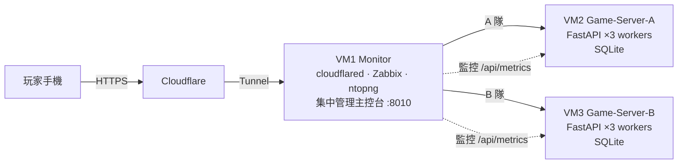
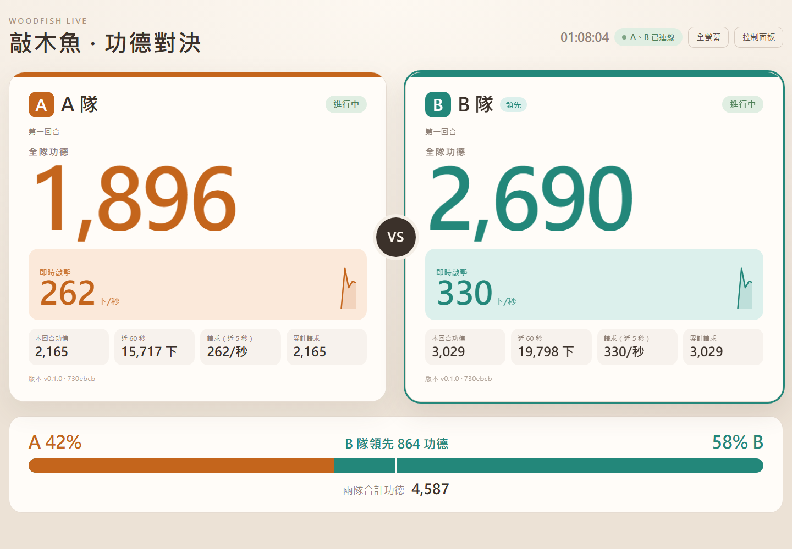

# 電子敲木魚 Woodfish

<p align="center">
  
</p>

> **English summary** — A mobile web game where players tap a wooden fish to earn "merit". I built it solo (FastAPI + vanilla JS + SQLite) as a live traffic generator for a graduate network-management course: about 60 classmates in two teams played on their phones while Zabbix and ntopng monitored the servers. The backend batches taps in memory and flushes them to SQLite every 0.5 s, which let each 4-vCPU VM sustain **2,000 requests/s** with p95 ≈ 30 ms on the LAN. It runs on three Ubuntu VMs behind a Cloudflare Tunnel, with a central admin console, audit logging, one-command PowerShell deployment and a custom load-testing tool.

## 專案介紹

國立中央大學資訊管理研究所「網路管理」課程專案。課程要求用真實玩家產生網路流量，再用 Zabbix 與 ntopng 觀察伺服器。我負責**敲木魚遊戲的完整開發與部署**（程式、架構、部署腳本、壓力測試皆由本人獨立完成）：課堂展示時**約 60 位同學**分成 A、B 兩隊，用自己的手機（4G／5G 或 Wi-Fi）連到各隊的遊戲伺服器，每敲一下就送出一個真實的 HTTP 請求，伺服器的流量變化即時顯示在監控系統上。

- **期間**：2026 年 11 月
- **角色**：個人開發（同一套環境上另有組員開發的另一款遊戲，兩者共存、互不干擾）
- **技術**：Python · FastAPI · Uvicorn · SQLite（WAL）· Vanilla JavaScript · Web Audio API · pytest · Ubuntu · systemd · Cloudflare Tunnel · Zabbix · ntopng · PowerShell · Git

### 系統架構



### 技術亮點

| 挑戰 | 做法 | 結果 |
|---|---|---|
| 每次敲擊都寫資料庫，SQLite 撐不住高頻寫入 | 敲擊先在記憶體累計，背景每 0.5 秒用**一次交易批次寫入**；以 `tap_id` 去重，重送不會重複計算 | 單台 4 vCPU 內網實測 **每秒 2,000 次請求、成功率 99.5–100%、p95 約 30 ms、CPU 約 55%** |
| 多個 worker 程序各有自己的記憶體，數字可能倒退 | 監控與主控台一律讀 SQLite；前端的全隊功德「同一次重設內只增不減」 | Zabbix 計數器保證單調遞增，Change per second 不會出現負值 |
| 找出公開網路路徑的真正瓶頸 | 自寫 HTTP/1.1 長連線壓測工具（`scripts/stress_test.py`），逐級加壓並同時讀取各台 CPU／網卡；從外部主機經 Cloudflare 測試 | 定位瓶頸在 Monitor VM 的虛擬網卡軟中斷（ksoftirqd 單核滿載），而非遊戲伺服器；比較 QUIC 與 HTTP/2 後保留 QUIC，持續上限約每秒 2,000 次 |
| 手機上的音效延遲與 iOS 靜音開關 | Web Audio 預先解碼 WAV；iOS 17+ 設定 `audioSession.type = "playback"`，切換 App 後自動恢復 | 敲擊動畫約 40 ms 內與音效同步 |
| 現場要能隨時控制兩隊回合、追查問題 | 集中管理主控台（每秒更新兩隊狀態與速率）、管理 API 限定來源 IP、所有管理操作寫入稽核日誌 | 可同時或個別開始／暫停／重設兩隊；任一台離線時另一台照常顯示 |
| 部署不能誤傷同機的監控系統與另一款遊戲 | PowerShell 部署腳本：預設唯讀檢查，確認 Commit 已推送、遠端工作樹乾淨，只重啟指定服務，並逐台驗證 Health 與版本 | 頁面顯示實際部署的 Commit，靜態資源以版本做 cache-busting |

### 我從這個專案學到的

- **先量測再優化**：從「每次敲擊寫一次資料庫」改成批次寫入前，先寫壓測工具量出瓶頸；外網測試時也是靠同時觀察 CPU、軟中斷與 UDP 緩衝區錯誤，才確定問題在虛擬網卡而不是程式。
- **清楚的取捨**：批次寫入代表當機時最多遺失 0.5 秒的敲擊，這是為了效能而明確接受、並寫進文件的取捨。
- **在既有環境上安全地工作**：監控系統、Tunnel 與另一款遊戲都已在運作，所有部署與設定變更都以「不影響其他服務、可還原」為前提。

### 畫面

<table>
  <tr>
    <td align="center" width="30%"><br>手機遊戲畫面：每敲一下送出一個 HTTP 請求</td>
    <td align="center"><br>集中管理主控台：兩隊即時功德、每秒敲擊數與領先比例</td>
  </tr>
</table>

<sub>截圖為本機以壓力測試工具產生的示範資料。</sub>

---

以下為完整技術文件（本機開發、API、監控設定、部署與維運）。

A、B 伺服器使用同一份程式碼，透過 `.env` 設定隊伍與各自獨立的 SQLite 資料庫。

## 本機啟動

```powershell
py -3 -m venv .venv
.\.venv\Scripts\Activate.ps1
python -m pip install -r requirements.txt
Copy-Item .env.example .env
python -m uvicorn app.main:app --reload
```

瀏覽 `http://127.0.0.1:8000/`。API 可用 `GET /health`、`GET /api/config`、`GET /api/stats?player_id=...` 與 `POST /api/tap`。

頁面右下角會顯示 `VERSION` 與執行中 Git Commit 短 SHA。`GET /api/version` 也會回傳相同資訊；Git 資訊無法取得時會顯示 `unknown`，不會使用假 SHA。

### 遊戲畫面

- **敲擊動畫**：每次敲擊，大和尚的手臂會揮下木槌敲中木魚，小和尚與木魚被壓一下再彈回，黃色敲擊線閃動。敲中的畫面在約 40 ms 內出現，與音效同步。圖層由 `scripts/build_monk_layers.py` 從 `character-body-no-fish.png` 切出（`monk-big.png`、`monk-arm.png`、`monk-small.png`、`impact-marks.png`）；需要 Pillow 與 numpy，只在素材改變時執行。手機開啟「減少動態效果」時不播放動畫。
- **音效**：使用 Web Audio 預先解碼的 WAV，延遲低。iOS 17 以上設定 `navigator.audioSession.type = "playback"`，改走媒體音量，不受靜音開關影響；鎖螢幕或切換 App 後，下一次觸控會自動恢復。左上角的「音色」選單可切換小／中／大木魚與原本的音效（預設中木魚），選擇存在手機上。木魚音效由 `scripts/make_woodfish_sound.py` 合成。
- **我的功德**：由手機自己計算並存在 localStorage，敲擊時立即 +1，伺服器最終拒絕（例如回合暫停中）時扣回。換手機、換瀏覽器或清除網站資料會重新計算，不影響伺服器的全隊功德與請求數。
- **全隊功德**：來自伺服器；同一次重設內只會往上，避免不同 worker 的時間差讓數字倒退。API 回應中的 `reset_marker` 每次重設都會變大，手機看到變大時把我的功德與全隊功德歸零。

### Zabbix HTTP 敲擊請求監控

每台 Game Server 提供唯讀 `GET /api/metrics`。回應中的 `tap_requests_total` 是該台伺服器實際收到的 `POST /api/tap` HTTP 請求累積數，包含成功、失敗、重複與請求格式驗證失敗；它不是功德數、TCP 封包數或流量 Bytes。

```json
{
  "team_id": "A",
  "tap_requests_total": 1234,
  "server_time": "2026-11-03T14:00:00Z"
}
```

Zabbix 7.0 LTS 可在 A、B 主機各建立 HTTP agent item：

- URL：`http://127.0.0.1:8000/api/metrics`（在各 Game Server 本機監控時）
- Type of information：Numeric (unsigned)
- Preprocessing：JSONPath `$.tap_requests_total`
- Units：`req`
- Storage/速率：使用 **Change per second**（或在圖表中選每秒變化）得到 Requests/s

若由 VM 1 監控，URL 改為 `http://192.168.26.133:8000/api/metrics` 與 `http://192.168.26.135:8000/api/metrics`。請確保 Ubuntu 防火牆只允許監控來源；此 API 只讀、不改變玩家 API。

計數器儲存在各自 SQLite 的 `game_state.tap_requests_total`。服務重啟不會歸零；只有刪除/重建資料庫才會歸零。管理頁面的「重設功德」不會重設此 HTTP 請求計數器，以免 Zabbix 的 Change per second 出現負值；重設時會把當下的值記在 `tap_requests_reset_base`，集中管理頁面的「累計請求（重設後）」顯示兩者的差，因此會從 0 重新計算。

### 高流量架構

為了讓每台伺服器撐住每秒 2000 次敲擊，敲擊只更新記憶體（`app/store.py`），背景每 0.5 秒把這段時間的敲擊用一次交易寫入 SQLite：

- `/api/metrics` 與管理狀態直接讀 SQLite，因此 Zabbix 看到的數字**最多晚 0.5 秒**，但保證只增不減（多個 worker 時也一樣）。
- 正常重啟或部署會先寫入剩下的敲擊；**斷電或當機最多遺失最後 0.5 秒**，這是課堂展示接受的取捨。寫入失敗時，敲擊會留到下一次再寫。
- 暫停、結束、重設會先寫入記憶體中的敲擊再執行；`scripts/manage_round.py` 直接修改 SQLite 的結果，0.5 秒內會被各 worker 讀到。
- 重複的 `tap_id` 先在記憶體檢查，寫入時再由 `processed_taps` 檢查；`processed_taps` 只保留最近 120 秒，避免資料庫在高流量下一直變大。
- 每個請求的 Uvicorn 存取紀錄已關閉（每秒數千行日誌比敲擊本身更耗 CPU）；錯誤、啟動訊息與管理操作稽核照常記錄。

A、B 以 3 個 Uvicorn worker 執行（見「Ubuntu 部署」的 worker 設定）。2026-11-04 由 VM 1 經內網實測：每台每秒 2000 次成功率 99.5–100%、p95 約 30 ms、整台 CPU（4 vCPU）約 55%。經 Cloudflare 時瓶頸在 VM 1 的 cloudflared，估計兩台合計約每秒 2500–3500 次。

## 回合管理

管理指令只在伺服器本機執行，不提供公開重設 API：

```bash
python scripts/manage_round.py start --name "第一回合"
python scripts/manage_round.py pause
python scripts/manage_round.py reset
python scripts/manage_round.py end
```

`reset` 與管理頁面的「重設功德」相同：清除全隊功德、回合功德、所有玩家個人功德與已處理的敲擊識別碼，並更新 `tap_requests_reset_base`，讓手機上的我的功德一起歸零；不清除 `tap_requests_total` 與稽核日誌。`start` 會開始新回合並只清除本回合計數。

## A/B 集中管理

目前管理頁面由 Ubuntu-Monitor（VM 1，`192.168.26.131:8010`）提供。瀏覽器只連 VM 1，管理服務再透過內部網路呼叫 Game-Server-A（`192.168.26.133:8000`）與 Game-Server-B（`192.168.26.135:8000`）；瀏覽器不直接呼叫兩台遊戲伺服器的管理 API。

管理頁面每秒更新一次，顯示兩隊真實狀態、全隊功德、回合功德、近 60 秒敲擊速率、近 5 秒每秒點擊與每秒請求、累計請求（重設後）、連線狀態與部署 Commit，並支援個別或同時開始、暫停、繼續、結束與重設功德。分頁切到背景時暫停更新；每開一個分頁，每台遊戲伺服器約多一個每秒請求，不計入 `tap_requests_total`。共同操作會分別回報 A/B 結果；只有一隊成功時會顯示部分成功。重設需要瀏覽器確認，且會清除該隊全隊功德、回合功德、所有玩家個人功德與已處理的敲擊識別碼，因此所有手機下一次輪詢都會看到 0。

Game Server 的管理 API 只接受 `ADMIN_PROXY_IP`（預設 `192.168.26.131`）來源，避免玩家端直接控制回合。這不是登入驗證；集中管理無帳號密碼是課堂實驗的已知風險。

### VM 1 安裝管理服務

以下只應在 VM 1 執行，不會修改既有 `woodfish`、Zabbix、ntopng 或 `cloudflared` 服務：

```bash
cd /home/labuser/woodfish-game
cp .env.admin.example .env.admin
sudo cp systemd/woodfish-admin.service.example /etc/systemd/system/woodfish-admin.service
sudo systemctl daemon-reload
sudo systemctl enable --now woodfish-admin
sudo systemctl status woodfish-admin
curl -sS http://127.0.0.1:8010/health
```

管理頁面只在內網使用：`http://192.168.26.131:8010/`。8010 不使用 Zabbix HTTP、ntopng 的 3001，也不改動現有 Tunnel。**管理頁面沒有登入驗證，不要建立公開的 Cloudflare route**，否則任何人都能重設或結束回合；若日後確實需要外網存取，必須先加上 Cloudflare Access 等驗證。

### 管理服務更新與驗證

```bash
cd /home/labuser/woodfish-game
git pull --ff-only origin main
.venv/bin/pip install -r requirements.txt
sudo systemctl restart woodfish-admin
curl -sS http://127.0.0.1:8010/api/admin/status
sudo journalctl -u woodfish-admin -n 50 --no-pager
```

若 A 或 B 離線，頁面會保留另一隊實際資料並明確顯示離線；不會使用模擬值。

## 測試與負載測試

```bash
python -m pytest
```

壓力測試只能在已獲授權、沒有人在玩的時候執行；測試會真的增加功德與 `tap_requests_total`，結束後請在管理頁按「重設功德」。小量測試：

```bash
python scripts/load_test.py --url http://127.0.0.1:8000 --requests 100 --concurrency 10
```

逐級加壓測試（固定每秒速率，找出撐不住的點，並換算網速）：

```bash
# 內網：從 VM 1 執行（Windows 筆電本身送不出每秒數千次）。腳本複製到 /tmp，用 VM 1 的 woodfish venv，測完刪除
python stress_test.py --engine raw --target A=http://192.168.26.133:8000 --target B=http://192.168.26.135:8000 --rates 500,1000,1500,2000

# 從 Windows 執行時可加 SSH 別名，同時讀取伺服器 CPU、RAM 與網卡流量
python scripts\stress_test.py --target A=http://192.168.26.133:8000=woodfish-a --target B=http://192.168.26.135:8000=woodfish-b
```

`--engine raw` 是精簡的 HTTP/1.1 長連線用戶端（支援 http 與 https），比 httpx 送得快很多。每次有效敲擊都是一個獨立 POST，伺服器用 `tap_id` 去重。

## Ubuntu 部署

### Windows SSH 自動部署

部署腳本只使用 SSH、Git、既有 Python venv 與既有 systemd 服務；不修改 `.env`、`.env.admin`、SQLite、Cloudflare、Zabbix 或 ntopng。預設為只讀檢查，只有加入 `-Deploy` 才會更新遠端。

先確認 SSH aliases `woodfish-a`、`woodfish-b`、`woodfish-monitor` 可免密碼登入：

```powershell
ssh woodfish-a "hostname"
ssh woodfish-b "hostname"
ssh woodfish-monitor "hostname"
```

只讀檢查三台：

```powershell
.\scripts\check-servers.ps1 -Target All
```

只讀檢查單台：

```powershell
.\scripts\check-servers.ps1 -Target A
.\scripts\check-servers.ps1 -Target B
.\scripts\check-servers.ps1 -Target Monitor
```

部署順序固定為 A、B、Monitor。部署前腳本會確認本機 `main` 工作樹乾淨、`HEAD` 已推送到 `origin/main`，並逐台確認遠端工作樹乾淨且看得到預期 Commit。部署時只重啟對應服務，並逐台驗證 Commit、systemd active、Health 與 A/B `TEAM_ID`。

```powershell
# 先做完整本機/遠端檢查，不修改遠端
.\scripts\deploy.ps1 -Target All

# 明確同意後才部署 A、B、Monitor
.\scripts\deploy.ps1 -Target All -Deploy
```

目前三台 VM 必須預先為指定服務設定 NOPASSWD。部署腳本所有 SSH 都使用 `BatchMode=yes`，部署前會以唯讀方式驗證 sudo 權限；部署時只執行以下精確重啟指令：

```text
sudo -n /usr/bin/systemctl restart woodfish.service
sudo -n /usr/bin/systemctl restart woodfish-admin.service
```

若 NOPASSWD 權限不足，腳本會在部署前停止，不會等待密碼，也不會使用 `sudo -S` 或標準輸入傳送密碼。`-InteractiveSudo` 已不再支援。

已知限制：Windows PowerShell 5.1 會把遠端的警告輸出當成錯誤。若 systemd 印出 daemon-reload 之類的提醒，部署腳本可能顯示失敗、但服務其實已成功重啟；請以 `.\scripts\check-servers.ps1 -Target Monitor` 確認。本機工作樹有未提交檔案時腳本會停止，請先提交或移開。

若任何一台 SSH、Git、依賴安裝、重啟或 Health 驗證失敗，腳本會停止並回報失敗，不會宣稱整體部署成功。腳本不使用 `git reset --hard`、`git push --force`、資料庫重建或 `apt upgrade`。

### 管理操作稽核

A、B 遊戲伺服器各自將管理操作寫入 SQLite 的 `admin_audit_logs`。開始、暫停、繼續、結束、重設功德、服務啟動，以及內部 CLI 操作都會記錄操作前後狀態、來源、來源 IP、成功與錯誤原因；一般玩家敲擊不會寫入稽核表。日誌最多保留最近 10,000 筆，重設功德不會刪除日誌。

遊戲伺服器可由 VM 1 讀取：

```bash
curl -sS 'http://127.0.0.1:8000/api/admin/audit-logs?limit=50'
```

集中管理頁面的「最近操作紀錄」會合併 A、B 最近 50 筆事件。若遊戲突然停止計數，先查看最後一筆事件的 `action`、`previous_status`、`new_status`、`source` 與 `error_message`，即可區分管理員操作、服務啟動與被拒絕的狀態變更。服務重啟只記錄當下保存的狀態，不會用 `.env` 的 `ROUND_STATUS` 覆寫 SQLite。

新增稽核表是啟動時的保留式 schema migration，不會刪除或重建 `woodfish.db`。正式部署前先停止對應服務並備份資料庫及 WAL 檔案：

```bash
sudo systemctl stop woodfish
cp data/woodfish.db data/woodfish.db.bak.$(date +%Y%m%d%H%M%S)
sudo systemctl start woodfish
```

若需要還原，先停止服務，將備份檔複製回原路徑後再啟動；不要刪除或單獨移動 `.db-wal`、`.db-shm`，並確認檔案擁有者仍為服務帳號。

兩台 VM 各自執行以下步驟，A 使用 `TEAM_ID=A`，B 使用 `TEAM_ID=B`；不要共用資料庫：

```bash
git clone <GitHub-Repository-URL> /home/labuser/woodfish-game
cd /home/labuser/woodfish-game
python3 -m venv .venv
.venv/bin/pip install -r requirements.txt
cp .env.example .env
editor .env
```

先備份並停止既有測試服務，再安裝本專案提供的範本：

```bash
sudo cp /etc/systemd/system/woodfish.service /etc/systemd/system/woodfish.service.bak.$(date +%Y%m%d%H%M%S)
sudo systemctl stop woodfish
sudo cp systemd/woodfish.service.example /etc/systemd/system/woodfish.service
sudo systemctl daemon-reload
sudo systemctl enable --now woodfish
sudo systemctl status woodfish
```

A、B 以 3 個 Uvicorn worker 執行，使用 systemd drop-in，不修改 `woodfish.service` 本身（需要 sudo，每台執行一次）：

```bash
sudo mkdir -p /etc/systemd/system/woodfish.service.d
printf '[Service]\nExecStart=\nExecStart=/home/labuser/woodfish-game/.venv/bin/uvicorn app.main:app --host 0.0.0.0 --port 8000 --workers 3\n' | sudo tee /etc/systemd/system/woodfish.service.d/workers.conf
sudo systemctl daemon-reload
sudo systemctl restart woodfish.service
```

還原成單一程序：刪除 `workers.conf` 後執行 `sudo systemctl daemon-reload` 與 `sudo systemctl restart woodfish.service`。每次重啟時每個 worker 各寫一筆 `system_startup` 稽核紀錄，所以會看到 3 筆。

更新：

```bash
cd /home/labuser/woodfish-game
git pull --ff-only origin main
.venv/bin/pip install -r requirements.txt
sudo systemctl restart woodfish
sudo journalctl -u woodfish -f
```

部署後驗證版本與快取：

```bash
cd /home/labuser/woodfish-game
git rev-parse --short HEAD
curl -sS http://127.0.0.1:8000/api/version
curl -sSI http://127.0.0.1:8000/
curl -sS https://woodfish-a.netplaylab.codes/api/version
curl -sS https://woodfish-b.netplaylab.codes/api/version
```

`git rev-parse --short HEAD` 必須與本機 `/api/version` 的 `commit` 相同；兩台伺服器的 API 回應可用來確認部署是否一致。HTML 使用 no-store，CSS、JavaScript 與圖片 URL 使用部署版本作為 cache-busting token。

服務固定監聽 `8000`；同一台 VM 的 `8100` 是另一個遊戲 Traffic Tug，不可占用。Cloudflare 路由、Zabbix、ntopng 不需修改。SQLite 備份可在停止服務後複製 `.env` 指定的資料庫檔案，重設資料庫前請先備份。

## 監控解讀

Zabbix 可觀察遊戲伺服器介面的 inbound/outbound、CPU、記憶體與可用的 packet rate。ntopng 能看到的端點與協定取決於 NAT、VMware 與 Cloudflare Tunnel；程式的 HTTP request 次數不等於網路封包數，也不代表能看到玩家原始 IP。請依實際監控畫面記錄結果。

`/api/metrics` 的 `tap_requests_total` 是應用層收到的 HTTP `POST /api/tap` 請求數；Zabbix 的 Change per second 是 Requests/s，不等於 TCP 封包速率或網路流量 Bytes/s。

## Git

```bash
git init
git add .
git commit -m "feat: initialize woodfish game"
git branch -M main
git remote add origin <GitHub-Repository-URL>
git push -u origin main
```

建議使用 `feature/*` 分支，測試後合併至 `main`；不要提交 `.env`、虛擬環境或 SQLite 資料庫。
